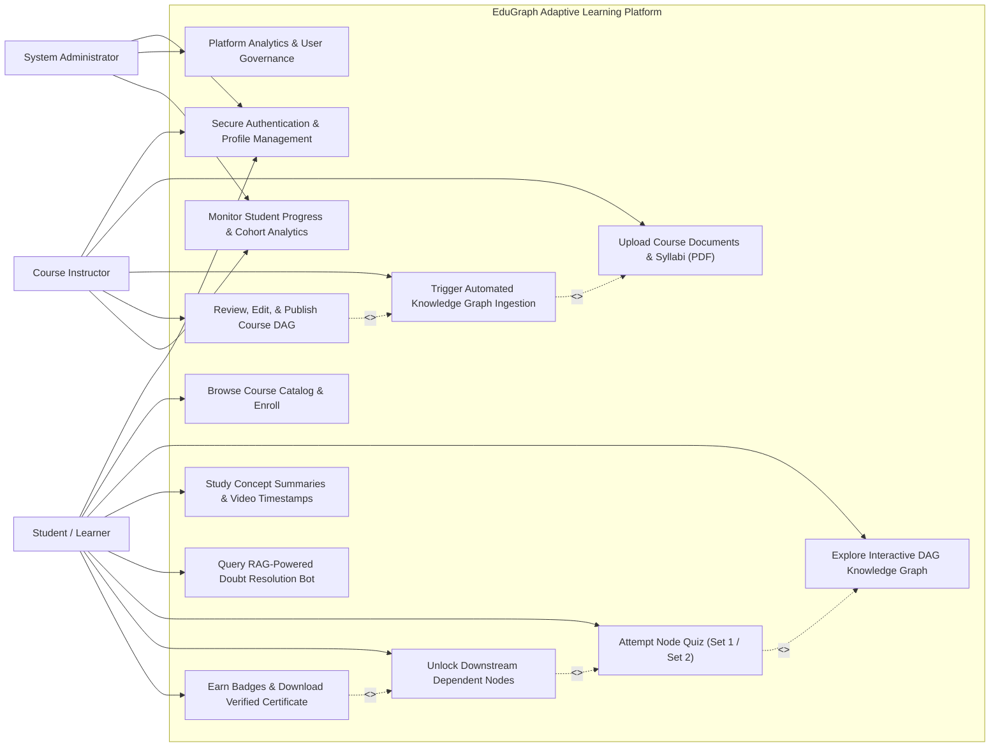
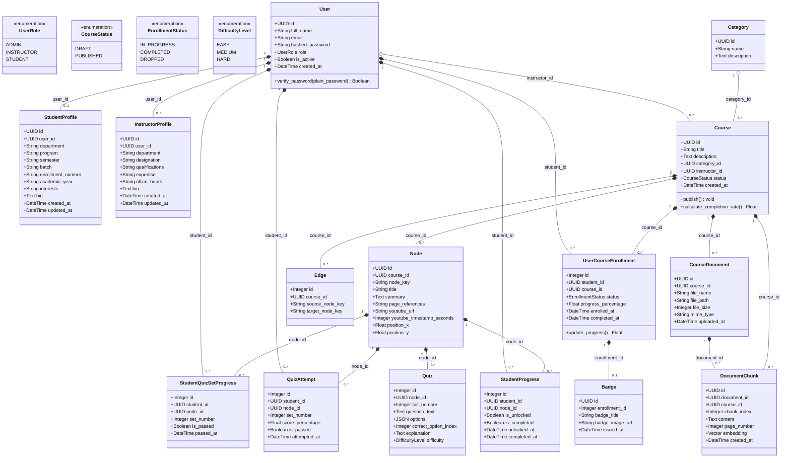
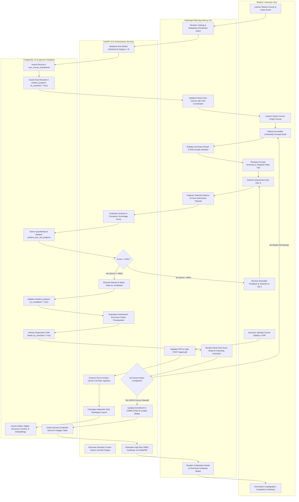
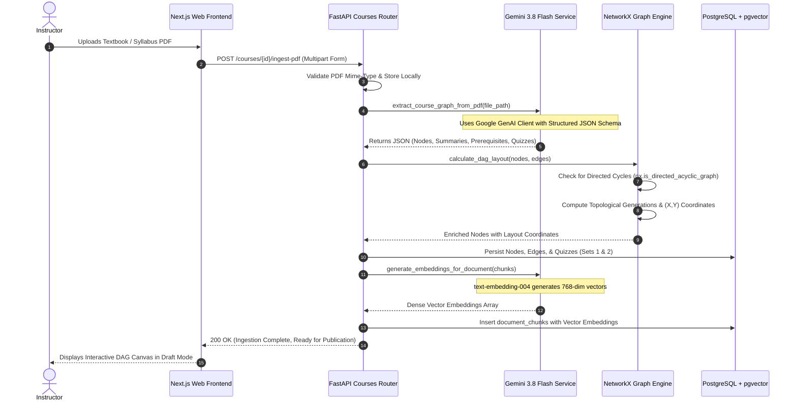
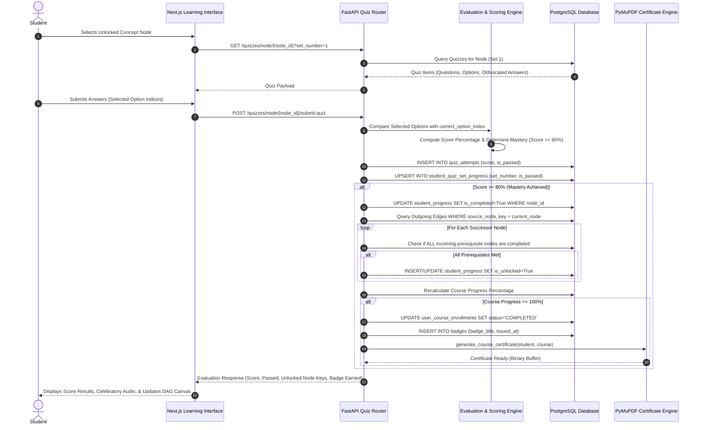
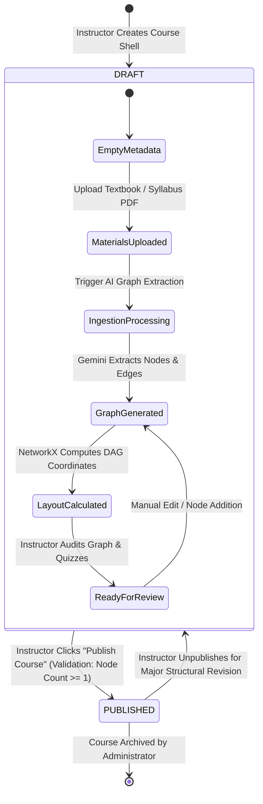
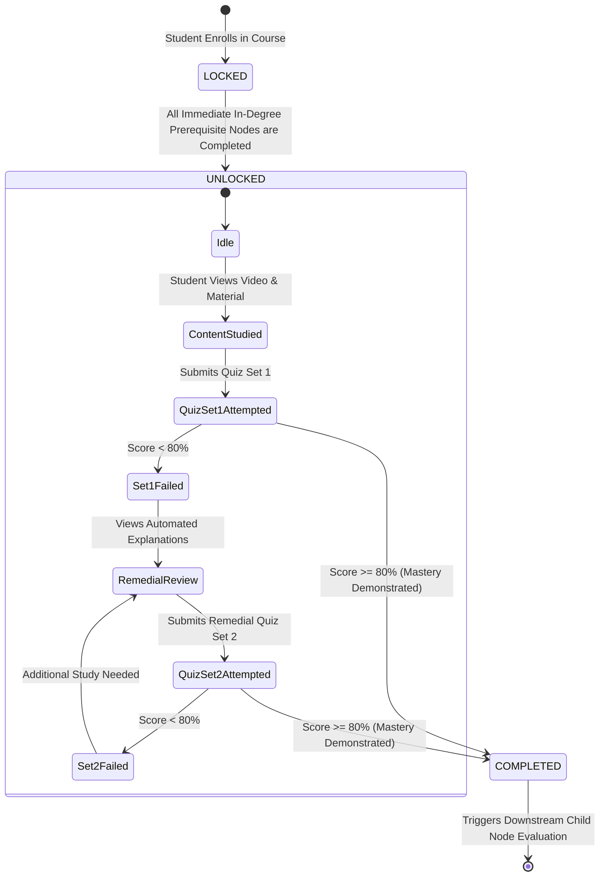
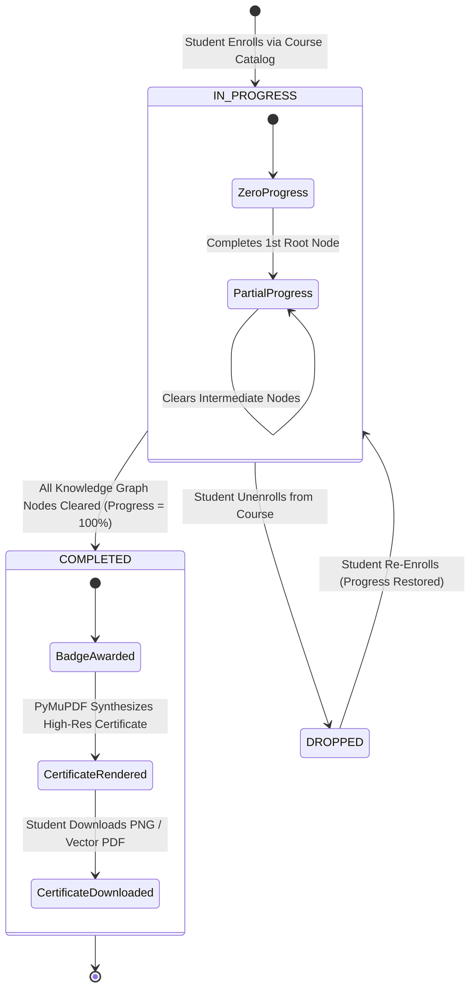

# EDUGRAPH: KNOWLEDGE GRAPH-BASED ADAPTIVE COURSEWARE SYSTEM

---

## 1. COVER PAGE

```
========================================================================================
                                     GLS UNIVERSITY
             FACULTY OF COMPUTER APPLICATIONS & INFORMATION TECHNOLOGY (FCAIT)
                                  AHMEDABAD, GUJARAT, INDIA
========================================================================================

                                  PROJECT REPORT ON
                  "EduGraph: Knowledge Graph-Based Adaptive Courseware System"

                                    SUBMITTED FOR
               PARTIAL FULFILLMENT OF THE REQUIREMENTS FOR THE DEGREE OF
                 INTEGRATED MASTER OF SCIENCE IN INFORMATION TECHNOLOGY
                                      [IMSc (IT)]
                                      SEMESTER IX

                                  COURSE CODE & TITLE:
                             221601907 – CAPSTONE PROJECT – II

========================================================================================

SUBMITTED BY:
----------------------------------------------------------------------------------------
Student Full Name        : [Student Name Placeholder]
Enrollment Number        : [Enrollment No. Placeholder]
Roll Number              : [Roll No. Placeholder]
Class / Division         : IMSc(IT) Semester IX – Division A
Academic Year            : 2025 – 2026

PROJECT GUIDANCE:
----------------------------------------------------------------------------------------
Internal Guide           : [Faculty Guide Name & Academic Designation]
Department               : Information Technology & Computer Applications
Institute                : Faculty of Computer Applications & Information Technology (FCAIT)
University               : GLS University, Ellisbridge, Ahmedabad – 380006

========================================================================================
                                   ACADEMIC YEAR: 2025–2026
========================================================================================
```

<div style="page-break-after: always;"></div>

---

## 2. COLLEGE CERTIFICATE

```
========================================================================================
                                     GLS UNIVERSITY
             FACULTY OF COMPUTER APPLICATIONS & INFORMATION TECHNOLOGY (FCAIT)
                           GLS Campus, Ellisbridge, Ahmedabad - 380006
========================================================================================

                                      CERTIFICATE

This is to certify that the Capstone Project work entitled:

           "EDUGRAPH: KNOWLEDGE GRAPH-BASED ADAPTIVE COURSEWARE SYSTEM"

is a bona fide record of independent project development carried out by:

                  Candidate Name    : [Student Name Placeholder]
                  Enrollment Number : [Enrollment No. Placeholder]
                  Roll Number       : [Roll No. Placeholder]
                  Program           : Integrated M.Sc. (Information Technology)
                  Semester          : Semester IX
                  Course Code       : 221601907 (Capstone Project – II)

in partial fulfillment of the academic requirements prescribed by GLS University for 
the award of the degree of Integrated Master of Science in Information Technology 
during the Academic Year 2025–2026.

The project work has been examined, verified, and found satisfactory in terms of scope, 
rigor, architectural integrity, and university documentation guidelines.


------------------------------------                 ------------------------------------
[Internal Guide Name]                                [Program Coordinator Name]
Project Internal Guide                               IMSc(IT) Program Coordinator
FCAIT, GLS University                                FCAIT, GLS University


------------------------------------                 ------------------------------------
[Dean / Director Name]                               External Examiner
Dean / Director                                      Academic / Industry Expert
Faculty of Computer Applications & IT                GLS University Evaluation Board
GLS University, Ahmedabad


Date of Examination : ______ / ______ / 2026
Institutional Seal  :
========================================================================================
```

<div style="page-break-after: always;"></div>

---

## 3. INDEX / TABLE OF CONTENTS

| Chapter No. | Topic / Section Title | Page Number |
| :--- | :--- | :--- |
| &mdash; | **Title Cover Page** | i |
| &mdash; | **College Certificate of Approval** | ii |
| &mdash; | **Acknowledgements & Declaration** | iii |
| &mdash; | **Abstract** | iv |
| **1.0** | **Brief of the System** | 1 |
| 1.1 | Background & Motivation | 1 |
| 1.2 | Problem Statement & Industry Gaps | 2 |
| 1.3 | Proposed Solution & Pedagogical Philosophy | 3 |
| 1.4 | Scope of the System | 5 |
| 1.5 | Technical Architecture & Technology Stack | 6 |
| **2.0** | **Software Requirements Specification (SRS)** | 9 |
| 2.1 | User Personas & Role-Based Access Control (RBAC) | 9 |
| 2.2 | Functional Requirements | 10 |
| 2.3 | Non-Functional Requirements | 12 |
| 2.4 | Hardware & Software Environment | 14 |
| **3.0** | **Object-Oriented System Modeling (UML Diagrams)** | 15 |
| 3.1 | Use Case Diagram & Actor Specifications | 15 |
| 3.2 | Class Diagram & Entity Relationships | 18 |
| 3.3 | Activity Diagram (Multi-Lane Swimlane Workflow) | 22 |
| 3.4 | Sequence Diagrams (Asynchronous Ingestion & Adaptive Assessment) | 25 |
| 3.5 | State Chart Diagrams (Course, Node, and Quiz Lifecycles) | 29 |
| **4.0** | **Database Architecture & Data Dictionary** | 33 |
| 4.1 | Schema Architecture & Profile Extension Pattern | 33 |
| 4.2 | Complete Data Dictionary (15 Relational Tables) | 35 |
| 4.2.1 | `users` Table | 35 |
| 4.2.2 | `student_profiles` Table | 36 |
| 4.2.3 | `instructor_profiles` Table | 37 |
| 4.2.4 | `categories` Table | 38 |
| 4.2.5 | `courses` Table | 39 |
| 4.2.6 | `course_documents` Table | 40 |
| 4.2.7 | `document_chunks` Table (pgvector Vector Store) | 41 |
| 4.2.8 | `nodes` Table (Knowledge Graph Vertices) | 42 |
| 4.2.9 | `edges` Table (Directed Acyclic Dependencies) | 43 |
| 4.2.10 | `quizzes` Table (Multi-Tier Assessment Pool) | 44 |
| 4.2.11 | `student_progress` Table (Node Mastery Tracking) | 45 |
| 4.2.12 | `student_quiz_set_progress` Table (Set-Level Clearance) | 46 |
| 4.2.13 | `quiz_attempts` Table (Evaluation Audit Trail) | 47 |
| 4.2.14 | `user_course_enrollments` Table (Course Progression) | 48 |
| 4.2.15 | `badges` Table (Milestone Credentials) | 49 |
| **5.0** | **User Interface & Route Directory** | 50 |
| 5.1 | Routing Directory & System Endpoints | 50 |
| 5.2 | Administrative & Instructor Portal | 53 |
| 5.3 | Student & Learner Interface | 57 |
| 5.4 | Interactive Knowledge Graph Visualizer & RAG Tutoring | 61 |
| 5.5 | Analytical Reports & Verifiable Certificate Generation | 64 |
| **6.0** | **System Testing, Verification & Validation** | 68 |
| 6.1 | Testing Methodology | 68 |
| 6.2 | Comprehensive Test Cases & Results | 69 |
| **7.0** | **Conclusion & Future Enhancements** | 73 |
| 7.1 | Key Project Deliverables & Contributions | 73 |
| 7.2 | System Limitations | 74 |
| 7.3 | Future Roadmap | 74 |
| **8.0** | **Academic References & Bibliography** | 76 |

<div style="page-break-after: always;"></div>

---

## 4. BRIEF OF SYSTEM

### 4.1 Background & Motivation
In modern computer science and higher education curricula, knowledge acquisition is non-linear. Core technical domains—such as Distributed Systems, Machine Learning, Database Internals, and Compiler Design—demand that foundational prerequisites be understood before higher-level conceptual abstractions can be mastered. 

Traditional Learning Management Systems (LMS) such as Moodle, Canvas, and Blackboard organize courseware into rigid, linear chapter lists. This chronological organization causes two critical pedagogical issues:
1. **Prerequisite Blindness**: Learners attempt advanced modules without having demonstrated competence in foundational dependencies, resulting in cognitive overload and high dropout rates.
2. **One-Size-Fits-All Curricula**: Highly proficient students are forced through redundant material, while struggling students lack contextual scaffolding and prerequisite remediation.

### 4.2 Problem Statement & Industry Gaps
Current educational technologies present several core limitations:
- **Manual, High-Cost Curriculum Mapping**: Structuring educational content into dependency trees is labor-intensive for professors and institutional instructional designers.
- **Static, Inelastic Assessments**: Quizzes often present identical questions on repeated attempts, facilitating memorization rather than concept mastery.
- **Disconnected Doubt Resolution**: Generic conversational LLMs (e.g., ChatGPT) frequently hallucinate answers that drift outside course boundaries, confusing learners.
- **Non-Verifiable Credentials**: Standard digital certificates are prone to tampering and lack cryptographic verification links.

### 4.3 Proposed Solution & System Architecture
**EduGraph** addresses these challenges by combining **Knowledge Graph Theory**, **Retrieval-Augmented Generation (RAG)**, and **Multi-Tier Adaptive Assessment**:

```mermaid
flowchart TD
    subgraph INGESTION ["AI Ingestion & Graph Extraction Pipeline"]
        PDF["Course Syllabi / Textbooks (PDF)"] --> GeminiIngest["Gemini 3.8 Flash Vision / Reasoning API"]
        GeminiIngest --> SchemaVal["Pydantic Structural Extraction"]
        SchemaVal --> TopoEngine["NetworkX DAG Engine (Cycle Detection & Layout)"]
        TopoEngine --> SQLStore["PostgreSQL Relational DB (Nodes & Edges)"]
        PDF --> Chunker["PyMuPDF Recursive Text Chunker"]
        Chunker --> Embedder["text-embedding-004 (768 Dim)"]
        Embedder --> VectorStore["pgvector Cosine Store"]
    end

    subgraph LEARNER_FLOW ["Learner Dynamic Traversal & Mastery"]
        UI["React Flow Interactive Graph UI"] --> NodeSelect["Learner Selects Unlocked Concept Node"]
        NodeSelect --> Study["Study Curated Summaries & Targeted Video Timestamp"]
        Study --> RAGChat["In-Context RAG Doubt Assistant"]
        Study --> QuizEngine["Adaptive Quiz Engine (Set 1 & Set 2 Pool)"]
        QuizEngine --> Eval["Pass Threshold >= 80% Check"]
        Eval -- "Passed" --> Unlock["Topological Successor Node Unlocking"]
        Eval -- "Failed" --> Remediation["Remedial Set 2 Generation & Review"]
        Unlock --> CertEngine["100% Course Clearance"]
        CertEngine --> PyMuPDFCert["High-Res Cryptographic Certificate Generation"]
    end
```



### 4.4 System Scope
- **Target Audience**: University departments, online degree programs, professional technical academies, and corporate continuous education platforms.
- **Functional Scope**:
  - Automated extraction of directed acyclic prerequisite graphs from unstructured PDF textbooks and lecture notes.
  - Interactive browser-based visualization of learning nodes using force-directed and hierarchical layouts.
  - Multi-set evaluation pools (Set 1 and Set 2) preventing answer memorization during re-tests.
  - Context-bounded RAG query resolution restricted exclusively to uploaded course materials.
  - Verifiable certificate issuance via vector-rendered documents with SHA-256 verification codes.
- **Architectural Scope**: High-concurrency asynchronous backend (FastAPI), modern responsive web client (Next.js 14 App Router), enterprise relational storage (PostgreSQL), and dense vector similarity indexing (`pgvector`).

### 4.5 Technology Stack Overview

| Layer | Technology | Version | Purpose in EduGraph |
| :--- | :--- | :--- | :--- |
| **Frontend Framework** | Next.js (React) | 14.2+ | Server-Side Rendering, App Router architecture, and responsive state management. |
| **Styling & Icons** | Tailwind CSS + Lucide | 3.4+ | Utility-first responsive design, modern dark/light themes, accessible components. |
| **Graph Visualization** | React Flow (`@xyflow/react`) | 12.0+ | Interactive node-edge canvas rendering, drag-and-drop navigation, and dynamic node styling. |
| **Backend Framework** | FastAPI (Python) | 0.115+ | High-throughput asynchronous REST API, Pydantic data validation, OpenAPI specification. |
| **ASGI Server** | Uvicorn | 0.30+ | Production asynchronous server implementation for Python. |
| **Relational Database** | PostgreSQL | 16.x | ACID-compliant storage for users, courses, nodes, edges, enrollments, and quiz attempts. |
| **Vector Extension** | pgvector | 0.7+ | Dense embedding storage and fast vector cosine distance (`<->`) similarity queries. |
| **ORM & Migrations** | SQLAlchemy | 2.0+ | Object Relational Mapping with AsyncEngine and declarative models. |
| **Large Language Models** | Google Gemini 3.8 Flash | v1beta | Automated knowledge extraction, DAG relationship synthesis, quiz generation, and RAG synthesis. |
| **Embedding Model** | `text-embedding-004` | Google GenAI | 768-dimensional dense mathematical text representations for semantic document search. |
| **Document Processing** | PyMuPDF (`fitz`) | 1.24+ | High-speed PDF text parsing, recursive layout chunking, and programmatic certificate creation. |
| **Graph Algorithms** | NetworkX | 3.3+ | DAG validation, topological sorting, cycle prevention, and hierarchical coordinate calculation. |
| **Security & Auth** | Python-Jose + Passlib | 3.3+ | Stateless JWT authentication, role claims, and Bcrypt cryptographic password hashing. |

<div style="page-break-after: always;"></div>

---

## 5. OBJECT-ORIENTED SYSTEM MODELING (UML DIAGRAMS)

### 5.1 Use Case Diagram

The EduGraph platform supports three primary actors: **System Administrator**, **Course Instructor**, and **Student (Learner)**. The system boundary delineates core functional capabilities across authentication, curriculum authoring, knowledge graph synthesis, adaptive evaluation, and credentialing.



#### Actor Specifications
1. **Student / Learner**:
   - Enrolls in published courses.
   - Navigates non-linear prerequisite graph paths.
   - Studies node content and submits adaptive quizzes to demonstrate mastery.
   - Solves contextual doubts via the course-bounded RAG assistant.
   - Receives automated badges and verifiable completion certificates upon reaching 100% course clearance.
2. **Course Instructor**:
   - Creates course metadata and uploads curriculum PDFs (textbooks, lecture notes).
   - Oversees automated knowledge graph and quiz generation via Google Gemini.
   - Audits, refines, and publishes course graphs.
   - Monitors student progress, quiz pass rates, and identifies curriculum bottlenecks via analytics.
3. **System Administrator**:
   - Manages institutional categories, user accounts, and role designations.
   - Audits platform performance, vector store health, and system-wide enrollment metrics.

<div style="page-break-after: always;"></div>

### 5.2 Class Diagram

The class diagram captures the object-oriented structure of EduGraph, detailing entities, attributes, primary methods, and associations implemented across the SQLAlchemy ORM layer.



<div style="page-break-after: always;"></div>

### 5.3 Activity Diagram (Multi-Lane Swimlane Workflow)

The activity diagram illustrates the cross-functional workflow of course ingestion, student enrollment, adaptive quiz evaluation, prerequisite graph unlocking, and certificate issuance across four distinct architectural swimlanes.



<div style="page-break-after: always;"></div>

### 5.4 Sequence Diagrams

#### 5.4.1 Course Ingestion & Topological Graph Generation Flow
This diagram details the sequence of interactions when an instructor submits a PDF coursebook, showing document processing, Gemini LLM reasoning, NetworkX cycle detection, and vector embedding persistence.



<div style="page-break-after: always;"></div>

#### 5.4.2 Student Adaptive Quiz Evaluation & Dynamic Prerequisite Unlocking Flow
This diagram demonstrates the lifecycle of a student attempting a concept assessment, evaluation against the 80% mastery threshold, and dynamic successor node unlocking.



<div style="page-break-after: always;"></div>

### 5.5 State Chart Diagrams

#### 5.5.1 Course Publication Lifecycle State Machine


#### 5.5.2 Student Node Mastery & Prerequisite Progression State Machine


#### 5.5.3 Enrollment & Credentialing State Machine


<div style="page-break-after: always;"></div>

---

## 6. DATA DICTIONARY

The EduGraph database architecture comprises **15 relational tables** modeled in PostgreSQL 16, utilizing UUID primary keys for entity identification, foreign key cascade constraints, and the `pgvector` extension for semantic embedding storage.

### 6.1 Entity: `users`
**Description**: Core authentication entity storing system credentials, account status, and base role categorization.

| Column Name | Data Type | Constraints | Nullable | Default Value | Description & Business Rules |
| :--- | :--- | :--- | :--- | :--- | :--- |
| `id` | `UUID` | **PK**, Index | **No** | `uuid_generate_v4()` | Unique system identifier for each authenticated user account. |
| `full_name` | `VARCHAR(100)` | &mdash; | **No** | &mdash; | Legal full name of the user (e.g., "Dr. Alan Turing"). |
| `email` | `VARCHAR(255)` | **Unique**, Index | **No** | &mdash; | Institutional or personal email address used for login. |
| `hashed_password` | `VARCHAR(255)` | &mdash; | **No** | &mdash; | Secure Bcrypt cryptographic password hash with salt. |
| `role` | `VARCHAR(50)` | Enum (`UserRole`) | **No** | `'STUDENT'` | Access level: `'ADMIN'`, `'INSTRUCTOR'`, or `'STUDENT'`. |
| `is_active` | `BOOLEAN` | &mdash; | **No** | `TRUE` | Indicates whether the account is currently enabled. |
| `created_at` | `TIMESTAMPTZ` | &mdash; | **No** | `CURRENT_TIMESTAMP` | UTC timestamp when the user account was provisioned. |

---

### 6.2 Entity: `student_profiles`
**Description**: Profile extension storing student-specific academic, program, and enrollment attributes via a 1-to-1 relationship with `users`.

| Column Name | Data Type | Constraints | Nullable | Default Value | Description & Business Rules |
| :--- | :--- | :--- | :--- | :--- | :--- |
| `id` | `UUID` | **PK**, Index | **No** | `uuid_generate_v4()` | Unique profile record identifier. |
| `user_id` | `UUID` | **FK** (`users.id`), **Unique**, Index | **No** | &mdash; | 1-to-1 foreign key to `users.id` with `ON DELETE CASCADE`. |
| `department` | `VARCHAR(100)` | &mdash; | **Yes** | `NULL` | Academic department (e.g., "Information Technology"). |
| `program` | `VARCHAR(100)` | &mdash; | **Yes** | `NULL` | Degree program (e.g., "Integrated M.Sc. (IT)"). |
| `semester` | `VARCHAR(50)` | &mdash; | **Yes** | `NULL` | Current academic semester (e.g., "Semester IX"). |
| `batch` | `VARCHAR(50)` | &mdash; | **Yes** | `NULL` | Graduation cohort (e.g., "2021-2026"). |
| `enrollment_number`| `VARCHAR(100)` | **Unique**, Index | **Yes** | `NULL` | University enrollment identifier (e.g., "20210012345"). |
| `academic_year` | `VARCHAR(50)` | &mdash; | **Yes** | `NULL` | Standing year (e.g., "5th Year"). |
| `bio` | `TEXT` | &mdash; | **Yes** | `NULL` | Brief academic summary written by the student. |
| `interests` | `VARCHAR(255)` | &mdash; | **Yes** | `NULL` | Comma-separated technical interest tags. |
| `created_at` | `TIMESTAMPTZ` | &mdash; | **No** | `CURRENT_TIMESTAMP` | Timestamp of profile creation. |
| `updated_at` | `TIMESTAMPTZ` | &mdash; | **No** | `CURRENT_TIMESTAMP` | Timestamp of most recent profile modification. |

---

### 6.3 Entity: `instructor_profiles`
**Description**: Profile extension storing faculty credentials, designations, and expertise via a 1-to-1 relationship with `users`.

| Column Name | Data Type | Constraints | Nullable | Default Value | Description & Business Rules |
| :--- | :--- | :--- | :--- | :--- | :--- |
| `id` | `UUID` | **PK**, Index | **No** | `uuid_generate_v4()` | Unique instructor profile record identifier. |
| `user_id` | `UUID` | **FK** (`users.id`), **Unique**, Index | **No** | &mdash; | 1-to-1 foreign key to `users.id` with `ON DELETE CASCADE`. |
| `department` | `VARCHAR(100)` | &mdash; | **Yes** | `NULL` | Institutional department (e.g., "Faculty of Computer Applications"). |
| `designation` | `VARCHAR(100)` | &mdash; | **Yes** | `NULL` | Academic title (e.g., "Professor", "Associate Professor"). |
| `qualifications` | `VARCHAR(255)` | &mdash; | **Yes** | `NULL` | Terminal degree credentials (e.g., "Ph.D. in CS, M.Tech"). |
| `expertise` | `VARCHAR(255)` | &mdash; | **Yes** | `NULL` | Primary research areas (e.g., "Knowledge Graphs, NLP, AI"). |
| `bio` | `TEXT` | &mdash; | **Yes** | `NULL` | Detailed academic and research curriculum vitae overview. |
| `office_hours` | `VARCHAR(255)` | &mdash; | **Yes** | `NULL` | Scheduled consultation hours (e.g., "Mon/Wed 2:00-4:00 PM"). |
| `created_at` | `TIMESTAMPTZ` | &mdash; | **No** | `CURRENT_TIMESTAMP` | Profile creation timestamp. |
| `updated_at` | `TIMESTAMPTZ` | &mdash; | **No** | `CURRENT_TIMESTAMP` | Timestamp of most recent update. |

---

### 6.4 Entity: `categories`
**Description**: Curricular classifications for grouping courses into functional domain areas.

| Column Name | Data Type | Constraints | Nullable | Default Value | Description & Business Rules |
| :--- | :--- | :--- | :--- | :--- | :--- |
| `id` | `UUID` | **PK**, Index | **No** | `uuid_generate_v4()` | Unique category identifier. |
| `name` | `VARCHAR(100)` | **Unique** | **No** | &mdash; | Domain name (e.g., "Artificial Intelligence", "Database Systems"). |
| `description` | `TEXT` | &mdash; | **Yes** | `NULL` | Narrative overview of the academic category scope. |

---

### 6.5 Entity: `courses`
**Description**: Primary courseware entity representing an adaptive course container managed by an instructor.

| Column Name | Data Type | Constraints | Nullable | Default Value | Description & Business Rules |
| :--- | :--- | :--- | :--- | :--- | :--- |
| `id` | `UUID` | **PK**, Index | **No** | `uuid_generate_v4()` | Unique course identifier. |
| `title` | `VARCHAR(255)` | &mdash; | **No** | &mdash; | Official title of the course curriculum. |
| `description` | `TEXT` | &mdash; | **Yes** | `NULL` | Comprehensive course syllabus overview. |
| `category_id` | `UUID` | **FK** (`categories.id`)| **No** | &mdash; | Association to academic domain category. |
| `instructor_id` | `UUID` | **FK** (`users.id`) | **No** | &mdash; | User ID of the owning faculty member. |
| `status` | `VARCHAR(50)` | Enum (`CourseStatus`) | **No** | `'DRAFT'` | Workflow state: `'DRAFT'` or `'PUBLISHED'`. |
| `created_at` | `TIMESTAMPTZ` | &mdash; | **No** | `CURRENT_TIMESTAMP` | Timestamp when the course shell was established. |

---

### 6.6 Entity: `course_documents`
**Description**: Tracks uploaded source PDF textbooks and lecture notes processed by the RAG and ingestion engine.

| Column Name | Data Type | Constraints | Nullable | Default Value | Description & Business Rules |
| :--- | :--- | :--- | :--- | :--- | :--- |
| `id` | `UUID` | **PK**, Index | **No** | `uuid_generate_v4()` | Unique document record identifier. |
| `course_id` | `UUID` | **FK** (`courses.id`), Index | **No** | &mdash; | Owning course identifier with `ON DELETE CASCADE`. |
| `file_name` | `VARCHAR(255)` | &mdash; | **No** | &mdash; | Original uploaded file name (e.g., "Distributed_Systems_v3.pdf"). |
| `file_path` | `VARCHAR(500)` | &mdash; | **No** | &mdash; | Storage path on the server filesystem. |
| `file_size` | `INTEGER` | &mdash; | **Yes** | `NULL` | Total size of the file in bytes. |
| `mime_type` | `VARCHAR(100)` | &mdash; | **No** | `'application/pdf'` | MIME type of the uploaded file. |
| `uploaded_at` | `TIMESTAMPTZ` | &mdash; | **No** | `CURRENT_TIMESTAMP` | Timestamp when file upload completed. |

---

### 6.7 Entity: `document_chunks`
**Description**: Stores semantically segmented text chunks and their dense mathematical embeddings for vector search.

| Column Name | Data Type | Constraints | Nullable | Default Value | Description & Business Rules |
| :--- | :--- | :--- | :--- | :--- | :--- |
| `id` | `UUID` | **PK**, Index | **No** | `uuid_generate_v4()` | Unique chunk record identifier. |
| `document_id` | `UUID` | **FK** (`course_documents.id`), Index | **No** | &mdash; | Source document reference with `ON DELETE CASCADE`. |
| `course_id` | `UUID` | **FK** (`courses.id`), Index | **No** | &mdash; | Course context reference for scoped filtering. |
| `chunk_index` | `INTEGER` | &mdash; | **No** | &mdash; | Zero-based sequence index within the document. |
| `content` | `TEXT` | &mdash; | **No** | &mdash; | Extracted textual content (typically 500-1000 tokens). |
| `page_number` | `INTEGER` | &mdash; | **Yes** | `NULL` | Original source PDF page number for citation back-links. |
| `embedding` | `VECTOR(768)` | Index (ivfflat/hnsw)| **Yes** | `NULL` | 768-dimensional dense vector generated via `text-embedding-004`. |
| `created_at` | `TIMESTAMPTZ` | &mdash; | **No** | `CURRENT_TIMESTAMP` | Timestamp of chunk extraction and vectorization. |

---

### 6.8 Entity: `nodes`
**Description**: Represents discrete knowledge concept nodes (vertices) within the course prerequisite Directed Acyclic Graph.

| Column Name | Data Type | Constraints | Nullable | Default Value | Description & Business Rules |
| :--- | :--- | :--- | :--- | :--- | :--- |
| `id` | `UUID` | **PK**, Index | **No** | `uuid_generate_v4()` | Unique concept node identifier. |
| `course_id` | `UUID` | **FK** (`courses.id`), Index | **No** | &mdash; | Parent course identifier with `ON DELETE CASCADE`. |
| `node_key` | `VARCHAR(50)` | &mdash; | **No** | &mdash; | Stable human-readable key (e.g., `'node_1'`, `'node_2'`). |
| `title` | `VARCHAR(255)` | &mdash; | **No** | &mdash; | Pedagogical concept title (e.g., "Raft Consensus Algorithm"). |
| `summary` | `TEXT` | &mdash; | **No** | &mdash; | Structured multi-paragraph concept summary. |
| `page_references`| `VARCHAR(255)`| &mdash; | **Yes** | `NULL` | Textbook citations (e.g., "Pages 142–158"). |
| `youtube_url` | `VARCHAR(500)` | &mdash; | **Yes** | `NULL` | Supplemental video explanation URL. |
| `youtube_timestamp_seconds`| `INTEGER` | &mdash; | **Yes** | `NULL` | Exact second offset for targeted video playback. |
| `position_x` | `FLOAT` | &mdash; | **No** | `0.0` | Computed horizontal coordinate for React Flow DAG layout. |
| `position_y` | `FLOAT` | &mdash; | **No** | `0.0` | Computed vertical coordinate for React Flow DAG layout. |

---

### 6.9 Entity: `edges`
**Description**: Represents directed prerequisite dependency arcs between knowledge graph nodes ($Source \rightarrow Target$).

| Column Name | Data Type | Constraints | Nullable | Default Value | Description & Business Rules |
| :--- | :--- | :--- | :--- | :--- | :--- |
| `id` | `INTEGER` | **PK**, Auto-Inc, Index| **No** | Serial | Internal primary key. |
| `course_id` | `UUID` | **FK** (`courses.id`), Index | **No** | &mdash; | Parent course identifier with `ON DELETE CASCADE`. |
| `source_node_key`| `VARCHAR(50)` | &mdash; | **No** | &mdash; | Prerequisite node key that must be mastered first. |
| `target_node_key`| `VARCHAR(50)` | &mdash; | **No** | &mdash; | Dependent successor node unlocked upon prerequisite completion. |

---

### 6.10 Entity: `quizzes`
**Description**: Stores multi-choice assessment items grouped into discrete sets (`set_number = 1` or `2`) per concept node.

| Column Name | Data Type | Constraints | Nullable | Default Value | Description & Business Rules |
| :--- | :--- | :--- | :--- | :--- | :--- |
| `id` | `INTEGER` | **PK**, Auto-Inc, Index| **No** | Serial | Internal quiz question identifier. |
| `node_id` | `UUID` | **FK** (`nodes.id`), Index | **No** | &mdash; | Concept node associated with this assessment item. |
| `set_number` | `INTEGER` | &mdash; | **No** | `1` | Evaluation tier (`1` for standard test, `2` for remedial test). |
| `question_text` | `TEXT` | &mdash; | **No** | &mdash; | Formatted question stem. |
| `options` | `JSON` | &mdash; | **No** | &mdash; | Array of 4 answer options (e.g., `["A", "B", "C", "D"]`). |
| `correct_option_index`| `INTEGER` | &mdash; | **No** | &mdash; | Index of correct answer (`0`, `1`, `2`, or `3`). |
| `explanation` | `TEXT` | &mdash; | **Yes** | `NULL` | Pedagogical rationale displayed after quiz submission. |
| `difficulty` | `VARCHAR(50)` | Enum (`DifficultyLevel`)| **No** | `'EASY'` | Question difficulty: `'EASY'`, `'MEDIUM'`, or `'HARD'`. |

---

### 6.11 Entity: `student_progress`
**Description**: Tracks student mastery and lock/unlock status for each discrete concept node in an enrolled course.

| Column Name | Data Type | Constraints | Nullable | Default Value | Description & Business Rules |
| :--- | :--- | :--- | :--- | :--- | :--- |
| `id` | `INTEGER` | **PK**, Auto-Inc, Index| **No** | Serial | Unique progress record identifier. |
| `student_id` | `UUID` | **FK** (`users.id`), Index | **No** | &mdash; | Student user reference with `ON DELETE CASCADE`. |
| `node_id` | `UUID` | **FK** (`nodes.id`), Index | **No** | &mdash; | Concept node reference with `ON DELETE CASCADE`. |
| `is_unlocked` | `BOOLEAN` | &mdash; | **No** | `FALSE` | Indicates if student has satisfied all upstream prerequisites. |
| `is_completed` | `BOOLEAN` | &mdash; | **No** | `FALSE` | Indicates if student has achieved $\ge 80\%$ on an active quiz set. |
| `unlocked_at` | `TIMESTAMPTZ` | &mdash; | **Yes** | `NULL` | Timestamp when all prerequisites were met. |
| `completed_at` | `TIMESTAMPTZ` | &mdash; | **Yes** | `NULL` | Timestamp when mastery threshold was satisfied. |

---

### 6.12 Entity: `student_quiz_set_progress`
**Description**: Tracks passing status per quiz set (`set_number = 1` vs `2`) to enable multi-tier remedial retakes.

| Column Name | Data Type | Constraints | Nullable | Default Value | Description & Business Rules |
| :--- | :--- | :--- | :--- | :--- | :--- |
| `id` | `INTEGER` | **PK**, Auto-Inc, Index| **No** | Serial | Unique record identifier. |
| `student_id` | `UUID` | **FK** (`users.id`), Index | **No** | &mdash; | Student user reference with `ON DELETE CASCADE`. |
| `node_id` | `UUID` | **FK** (`nodes.id`), Index | **No** | &mdash; | Concept node reference with `ON DELETE CASCADE`. |
| `set_number` | `INTEGER` | &mdash; | **No** | &mdash; | Quiz set tier (`1` or `2`). |
| `is_passed` | `BOOLEAN` | &mdash; | **No** | `FALSE` | Whether the student achieved $\ge 80\%$ on this specific set. |
| `passed_at` | `TIMESTAMPTZ` | &mdash; | **Yes** | `NULL` | Timestamp when set clearance occurred. |

*Table Constraint*: `UNIQUE (student_id, node_id, set_number)` guarantees one canonical progress tracking row per set.

---

### 6.13 Entity: `quiz_attempts`
**Description**: Historical audit trail capturing every quiz submission, score percentage, and mastery outcome.

| Column Name | Data Type | Constraints | Nullable | Default Value | Description & Business Rules |
| :--- | :--- | :--- | :--- | :--- | :--- |
| `id` | `INTEGER` | **PK**, Auto-Inc, Index| **No** | Serial | Unique attempt record identifier. |
| `student_id` | `UUID` | **FK** (`users.id`), Index | **No** | &mdash; | Submitting student reference with `ON DELETE CASCADE`. |
| `node_id` | `UUID` | **FK** (`nodes.id`), Index | **No** | &mdash; | Concept node reference with `ON DELETE CASCADE`. |
| `set_number` | `INTEGER` | &mdash; | **No** | `1` | Set number attempted during this session. |
| `score_percentage`| `FLOAT` | &mdash; | **No** | &mdash; | Numerical percentage achieved (e.g., `85.0`). |
| `is_passed` | `BOOLEAN` | &mdash; | **No** | &mdash; | Boolean flag: `TRUE` if `score_percentage >= 80.0`. |
| `attempted_at` | `TIMESTAMPTZ` | &mdash; | **No** | `CURRENT_TIMESTAMP` | Exact submission timestamp. |

---

### 6.14 Entity: `user_course_enrollments`
**Description**: Manages macro-level course enrollment, overall completion percentage, and completion timestamps.

| Column Name | Data Type | Constraints | Nullable | Default Value | Description & Business Rules |
| :--- | :--- | :--- | :--- | :--- | :--- |
| `id` | `INTEGER` | **PK**, Auto-Inc, Index| **No** | Serial | Primary key of the enrollment record. |
| `student_id` | `UUID` | **FK** (`users.id`), Index | **No** | &mdash; | Enrolled student reference with `ON DELETE CASCADE`. |
| `course_id` | `UUID` | **FK** (`courses.id`), Index | **No** | &mdash; | Target course reference with `ON DELETE CASCADE`. |
| `status` | `VARCHAR(50)` | Enum (`EnrollmentStatus`)| **No**| `'IN_PROGRESS'` | Progression state: `'IN_PROGRESS'`, `'COMPLETED'`, or `'DROPPED'`. |
| `progress_percentage`| `FLOAT` | &mdash; | **No** | `0.0` | Ratio of completed nodes to total course nodes (e.g., `66.67`). |
| `enrolled_at` | `TIMESTAMPTZ` | &mdash; | **No** | `CURRENT_TIMESTAMP` | Initial enrollment timestamp. |
| `completed_at` | `TIMESTAMPTZ` | &mdash; | **Yes** | `NULL` | Timestamp when `progress_percentage` reaches `100.0`. |

---

### 6.15 Entity: `badges`
**Description**: Stores verified course completion badges issued upon reaching 100% course clearance.

| Column Name | Data Type | Constraints | Nullable | Default Value | Description & Business Rules |
| :--- | :--- | :--- | :--- | :--- | :--- |
| `id` | `UUID` | **PK**, Index | **No** | `uuid_generate_v4()` | Unique credential record identifier. |
| `enrollment_id` | `INTEGER` | **FK** (`user_course_enrollments.id`), **Unique** | **No** | &mdash; | 1-to-1 link to the completed course enrollment. |
| `badge_title` | `VARCHAR(255)` | &mdash; | **No** | &mdash; | Canonical credential title (e.g., "Master of Distributed Systems Graph"). |
| `badge_image_url`| `VARCHAR(500)` | &mdash; | **Yes** | `NULL` | Static or vector asset URL representing the badge graphic. |
| `issued_at` | `TIMESTAMPTZ` | &mdash; | **No** | `CURRENT_TIMESTAMP` | Timestamp of badge issuance. |

<div style="page-break-after: always;"></div>

---

## 7. SYSTEM SCREENSHOTS & ROUTE DIRECTORY

### 7.1 Complete Route & API Endpoint Directory

The EduGraph platform implements a clear separation between frontend application routes (Next.js 14 App Router) and backend service endpoints (FastAPI RESTful Architecture).

```
========================================================================================
                              FRONTEND APPLICATION ROUTES
========================================================================================
Route Path                              Access Level        Primary Purpose & Interface
----------------------------------------------------------------------------------------
/login                                  Public              Bcrypt user credential authentication & JWT token issuance.
/register                               Public              Multi-role registration with profile extension fields.
/admin/dashboard                        Admin Only          System health, user role management, platform analytics.
/admin/courses                          Admin Only          Platform-wide course oversight, moderation, and category creation.
/instructor/dashboard                   Instructor Only     Course creation, PDF ingestion status, cohort overview.
/instructor/courses                     Instructor Only     Directory of created courseware drafts and published offerings.
/instructor/course/[id]                 Instructor Only     Interactive DAG review canvas, node editor, and publishing controls.
/instructor/course/[id]/analytics       Instructor Only     Per-node drop-off rates, quiz difficulty metrics, CSV exports.
/instructor/profile                     Instructor Only     Faculty credentials, research areas, office hours, and biography.
/student/dashboard                      Student Only        Active courses, progression progress bars, and recent badges.
/student/catalog                        Student Only        Searchable course repository with category filtering and enrollment.
/student/course/[id]                    Student Only        Interactive React Flow DAG canvas, concept study drawer, RAG chatbot.
/student/node/[nodeId]/quiz             Student Only        Interactive timed multi-set assessment interface.
/student/quiz/[courseId]                Student Only        Comprehensive course evaluation gateway.
/student/progress                       Student Only        Detailed milestone analytics and concept mastery matrix.
/student/badges                         Student Only        Earned credentials showcase and certificate download hub.
/student/profile                        Student Only        Academic standing, degree program, batch, and interests.
========================================================================================
```

```
========================================================================================
                                BACKEND API ENDPOINTS
========================================================================================
Method    Endpoint URL                                 Role       Description
----------------------------------------------------------------------------------------
POST      /auth/register                               Public     Registers user and creates student/instructor profile.
POST      /auth/login                                  Public     Validates credentials and returns JWT Bearer token.
GET       /auth/me                                     Auth       Retrieves current authenticated user and profile record.
PUT       /auth/profile                                Auth       Updates biographical and academic profile fields.
GET       /courses/                                    Auth       Lists published courses for catalog with category filter.
POST      /courses/                                    Instructor Creates new course shell in DRAFT state.
GET       /courses/{id}                                Auth       Retrieves course details, nodes, and directed edges.
PUT       /courses/{id}/publish                        Instructor Validates node count >= 1 and transitions course to PUBLISHED.
POST      /courses/{id}/ingest-pdf                     Instructor Uploads PDF, triggers Gemini 3.8 Flash extraction & NetworkX.
POST      /courses/{id}/chat                           Student    RAG-powered conversational doubt resolution over course chunks.
GET       /courses/{id}/export/analytics               Instructor Generates downloadable CSV report of cohort performance.
POST      /enrollments/courses/{id}/enroll             Student    Enrolls student in course and unlocks root DAG nodes.
GET       /enrollments/my                              Student    Retrieves student's active and completed course enrollments.
GET       /enrollments/badges/me                       Student    Retrieves all earned course completion badges for student.
GET       /enrollments/{course_id}/certificate/download Student   Generates and streams 1920x1080 PyMuPDF certificate.
GET       /quizzes/node/{node_id}                      Student    Fetches quiz questions for active set (answers stripped).
POST      /quizzes/node/{node_id}/submit-quiz          Student    Evaluates answers, records attempt, and unlocks child nodes.
========================================================================================
```

<div style="page-break-after: always;"></div>

### 7.2 Administrative & Instructor Interfaces

#### 7.2.1 Instructor Course Creation & Multi-PDF Ingestion Portal (`/instructor/dashboard`)
*User Interface Layout*:
The Instructor Dashboard provides a unified command center for academic courseware authoring. The top section presents key institutional metrics: **Total Courses Authored**, **Active Enrolled Students**, **Average Completion Rate**, and **Pending Ingestion Tasks**. 

Below the metric cards, an interactive upload zone accepts syllabus documents and multi-volume PDF textbooks. When a file is uploaded, the interface initiates an asynchronous ingestion task via `POST /courses/{id}/ingest-pdf`, displaying a real-time progress stepper:
1. *Document Parsing & Text Extraction* (PyMuPDF)
2. *AI Concept Extraction & Dependency Identification* (Gemini 3.8 Flash)
3. *Topological DAG Sorting & Layout Optimization* (NetworkX)
4. *Vector Space Chunking & Embeddings Generation* (`text-embedding-004`)

```
+---------------------------------------------------------------------------------------+
|  EDUGRAPH  |  Instructor Portal        [Dashboard] [My Courses] [Analytics]  (Prof. Alan) |
+---------------------------------------------------------------------------------------+
|                                                                                       |
|  [ + Create New Course ]                                                              |
|                                                                                       |
|  +-------------------+  +-------------------+  +-------------------+  +---------------+
|  | Total Courses     |  | Total Students    |  | Avg. Completion   |  | Ingest Status |
|  |        12         |  |       480         |  |      74.2%        |  |  All Synced   |
|  +-------------------+  +-------------------+  +-------------------+  +---------------+
|                                                                                       |
|  COURSE INGESTION ENGINE                                                              |
|  +---------------------------------------------------------------------------------+  |
|  |  Drag and Drop Course Textbooks / Syllabi (PDF format)                          |  |
|  |  [ Selected: Distributed_Systems_Tanenbaum.pdf (18.4 MB) ]                      |  |
|  |                                                                                 |  |
|  |  Step 1: Parsing PDF Content               [ Completed - 428 Pages ]            |  |
|  |  Step 2: Gemini Graph Extraction           [ Completed - 14 Nodes Identified ]  |  |
|  |  Step 3: NetworkX DAG Validation           [ Completed - 0 Cycles Detected ]    |  |
|  |  Step 4: Vector Embeddings (pgvector)      [ Completed - 856 Chunks Stored ]    |  |
|  |                                                                                 |  |
|  |  [ View Generated Graph in Editor ]                 [ Publish Course to Catalog ] |
|  +---------------------------------------------------------------------------------+  |
+---------------------------------------------------------------------------------------+
```

<div style="page-break-after: always;"></div>

#### 7.2.2 Instructor Cohort Analytics & Bottleneck Identification (`/instructor/course/[id]/analytics`)
*User Interface Layout*:
This interface surfaces curriculum analytics for an individual course offering. It features a graphical pass-rate breakdown per concept node, identifying where students encounter difficulty. A **Remediation Alert** highlights nodes where first-attempt failure rates exceed 30%, signaling that the learning summary or quiz questions may require revision. The interface includes an **Export Performance CSV** button that triggers `/courses/{id}/export/analytics`.

```
+---------------------------------------------------------------------------------------+
|  EDUGRAPH  |  Distributed Systems Analytics                 [Export CSV Report]       |
+---------------------------------------------------------------------------------------+
|                                                                                       |
|  ENROLLMENT SUMMARY: 142 Active Students | 98 Completed (69.0%) | Avg. Score: 83.4%   |
|                                                                                       |
|  CONCEPT NODE PERFORMANCE BREAKDOWN:                                                  |
|  Node Key   Node Concept Title              Set 1 Pass %   Set 2 Pass %   Drop-off    |
|  ----------------------------------------------------------------------------------   |
|  node_1     System Architectures & Models      94.2%          100.0%         0.0%     |
|  node_2     Clock Synchronization & Lamport    71.4%           88.2%         4.2%     |
|  node_3     Raft Consensus Algorithm           54.1% [ALERT]   81.0%        14.8%     |
|  node_4     Byzantine Fault Tolerance          62.8%           84.5%         9.1%     |
|  node_5     Distributed Key-Value Stores       89.0%           96.4%         1.4%     |
|                                                                                       |
|  [!] CURRICULUM BOTTLENECK DETECTED: Node 3 (Raft Consensus) requires 45.9% Set-2     |
|      remediation. Recommended action: Add supplementary video lecture or review quiz. |
+---------------------------------------------------------------------------------------+
```

<div style="page-break-after: always;"></div>

### 7.3 Student & Learner Interface

#### 7.3.1 Student Learning Dashboard (`/student/dashboard`)
*User Interface Layout*:
The student dashboard opens with an overview of academic progress: active enrollments, overall completion percentages, hours invested, and earned completion credentials. Each enrolled course is presented as an interactive progress card with a **Resume Learning** action that directs the student to the active course DAG.

```
+---------------------------------------------------------------------------------------+
|  EDUGRAPH  |  Learner Hub          [My Courses] [Catalog] [Badges] [Profile]  (Alex K.)|
+---------------------------------------------------------------------------------------+
|                                                                                       |
|  WELCOME BACK, ALEX!                                                                  |
|  Degree: IMSc(IT) - Sem IX | Enrollment: 20210012345 | Current Standing: 5th Year     |
|                                                                                       |
|  +--------------------+  +--------------------+  +--------------------+               |
|  | Courses Enrolled   |  | Concepts Mastered  |  | Verified Badges    |               |
|  |         4          |  |        38 / 52     |  |         3          |               |
|  +--------------------+  +--------------------+  +--------------------+               |
|                                                                                       |
|  CONTINUE LEARNING:                                                                   |
|  +---------------------------------------------------------------------------------+  |
|  | DISTRIBUTED SYSTEMS (CS-901)                                                    |  |
|  | Progress: [=====================================>---------] 78.5%               |  |
|  | Current Objective: Node 4 - Byzantine Fault Tolerance (Unlocked)              |  |
|  | [ Resume Interactive Graph ]                               [ Open Doubt Bot ]   |  |
|  +---------------------------------------------------------------------------------+  |
|  | COMPILER DESIGN & OPTIMIZATION (CS-903)                                         |  |
|  | Progress: [================================================] 100.0% COMPLETED   |  |
|  | [ View Completed Graph ]                          [ Download Certificate (PNG) ]|  |
|  +---------------------------------------------------------------------------------+  |
+---------------------------------------------------------------------------------------+
```

<div style="page-break-after: always;"></div>

#### 7.3.2 Interactive React Flow Knowledge Graph Canvas (`/student/course/[id]`)
*User Interface Layout*:
The core learning interface of EduGraph renders the course Directed Acyclic Graph on an infinite zoomable, draggable canvas powered by React Flow. Concept nodes are rendered with distinct visual states based on student progress:
- **Locked Nodes** (Muted gray border, padlock icon): Prerequisite dependencies have not yet been satisfied. Clicking displays a tooltip listing required prerequisite nodes.
- **Unlocked / Available Nodes** (Emerald green pulsating glow, book icon): All incoming prerequisite dependencies are completed. Ready for study.
- **Mastered / Completed Nodes** (Solid dark navy/gold border, checkmark icon): Student has satisfied the $\ge 80\%$ mastery threshold.

Selecting an unlocked node opens a flyout drawer containing:
1. Curated concept summary with textbook page references.
2. An embedded video player pre-seeked to the exact conceptual timestamp.
3. An integrated RAG Chatbot scoped to the course's vector embeddings.
4. An **Attempt Mastery Quiz** button.

```
+---------------------------------------------------------------------------------------+
|  < Back to Catalog  |  Distributed Systems (CS-901)          Progress: 8/12 Mastered  |
+---------------------------------------------------------------------------------------+
|  [Canvas Zoom: 100%] [Reset Layout] [Legend: (X) Locked  (*) Ready  (#) Mastered]    |
|                                                                                       |
|       (#) System Models                                                               |
|             \                                                                         |
|              --> (#) Lamport Clocks                                                   |
|                    \                                 CONCEPT STUDY DRAWER             |
|                     --> (*) Raft Consensus <========|+-------------------------------+|
|                           \                         || Node 3: Raft Consensus        ||
|                            --> (X) BFT Protocols    || Page Ref: Tanenbaum pp. 182   ||
|                                                     ||                               ||
|                                                     || Summary:                      ||
|                                                     || Raft decomposes state machine ||
|                                                     || consensus into leader elect,  ||
|                                                     || log replication, and safety...||
|                                                     ||                               ||
|                                                     || Supplemental Video:           ||
|                                                     || [ > Play Clip (Start 04:12) ] ||
|                                                     ||                               ||
|                                                     || RAG Doubt Resolution:         ||
|                                                     || Q: What happens on split vote?||
|                                                     || A: Candidates randomize their ||
|                                                     || election timeouts (150-300ms) ||
|                                                     ||                               ||
|                                                     || [ Attempt Quiz (Set 1) -> ]   ||
|                                                     |+-------------------------------+|
+---------------------------------------------------------------------------------------+
```

<div style="page-break-after: always;"></div>

#### 7.3.3 Adaptive Timed Quiz Interface (`/student/node/[nodeId]/quiz`)
*User Interface Layout*:
The assessment screen presents multiple-choice questions for the active set. Questions display clear radio buttons, and the submission action triggers an evaluation against `correct_option_index`. 

Upon submission, the interface displays immediate scoring feedback:
- If **Score $\ge 80\%$**: A celebratory modal triggers, marks the node as completed, and animates the unlocking of downstream child nodes on the DAG canvas.
- If **Score $< 80\%$**: Detailed explanations are revealed, and the student is transitioned to **Remedial Quiz Set 2** with a fresh set of questions on the same concept, preventing rote answer memorization.

```
+---------------------------------------------------------------------------------------+
|  EDUGRAPH ASSESSMENT ENGINE  |  Node: Raft Consensus Algorithm (CS-901)  |  Timer: 09:42  |
+---------------------------------------------------------------------------------------+
|                                                                                       |
|  QUESTION 1 OF 5  [Difficulty: MEDIUM]  [Quiz Set: 1]                                 |
|  During a Raft leader election, what mechanism prevents two candidate nodes from      |
|  repeatedly splitting the vote and causing an indefinite election deadlock?           |
|                                                                                       |
|    ( ) A) The cluster falls back to Paxos two-phase prepare messages.                 |
|    (*) B) Randomized election timeouts spread candidate declarations across time.    |
|    ( ) C) The node with the lowest IP address is deterministically selected.         |
|    ( ) D) The previous leader's term is forcibly extended by the client proxy.        |
|                                                                                       |
|  ------------------------------------------------------------------------------------ |
|  [ Previous Question ]                                          [ Next Question -> ]  |
|                                                                                       |
|                                 [ Submit Quiz for Evaluation ]                        |
+---------------------------------------------------------------------------------------+
```

<div style="page-break-after: always;"></div>

### 7.4 Reports, Analytics & Cryptographic Certificate Generation

#### 7.4.1 High-Resolution Verifiable Certificate of Completion
The `certificate_service.py` module uses **PyMuPDF (`fitz`)** to render vector-sharp, tamper-resistant certificates (1920 $\times$ 1080 resolution) streamed directly via `GET /enrollments/{course_id}/certificate/download`. 

*Design Elements*:
- **Color Palette**: Dark Emerald Navy (`#112217`), Prestige Gold (`#D4AF37`), Sage Green (`#2E5A44`), and Cream Canvas (`#FBFBFB`).
- **Typography & Framing**: Triple ornamental borders, decorative geometric corner embellishments, institutional insignia header, and student name hero display.
- **Verification Watermark**: Unique Certificate Identification Number (UUID v4) and cryptographic validation hash linking the credential to the university database record.

```
+=======================================================================================+
|#|===================================================================================|#|
| |  [+]                  EDUGRAPH KNOWLEDGE GRAPH ADAPTIVE PLATFORM              [+] | |
| |                                                                                   | |
| |                           CERTIFICATE OF COMPLETION                               | |
| |                           =========================                               | |
| |                                                                                   | |
| |                               PROUDLY PRESENTED TO:                               | |
| |                                                                                   | |
| |                                ALEX K. MERCER                                     | |
| |                                --------------                                     | |
| |                                                                                   | |
| |  for successfully mastering all conceptual nodes and prerequisite dependencies    | |
| |  in the rigorous curriculum of:                                                   | |
| |                                                                                   | |
| |                     DISTRIBUTED SYSTEMS & CONSENSUS PROTOCOLS                     | |
| |                                                                                   | |
| |  Issued on: October 24, 2026                 Certificate ID: CERT-8F7B-9A40-2026  | |
| |                                                                                   | |
| |  ----------------------------                      ----------------------------   | |
| |  Prof. Alan Turing, Ph.D.                          Dean of Computer Applications  | |
| |  Internal Guide & Instructor                       FCAIT, GLS University          | |
|#|===================================================================================|#|
+=======================================================================================+
```

<div style="page-break-after: always;"></div>

#### 7.4.2 Cohort Performance Analytics Export Report
Accessible to instructors and academic administrators, this report provides student-level accountability data exported via `GET /courses/{id}/export/analytics`.

*Sample Export Data*:

| Student ID | Student Full Name | Enrollment Number | Program | Nodes Mastered | Quiz Avg (%) | Total Attempts | Status | Completion Date |
| :--- | :--- | :--- | :--- | :--- | :--- | :--- | :--- | :--- |
| `usr_a109` | Alex K. Mercer | 20210012345 | IMSc(IT) | 12 / 12 | 89.2% | 14 | COMPLETED | 2026-10-24 14:22 UTC |
| `usr_b218` | Priya N. Patel | 20210012389 | IMSc(IT) | 12 / 12 | 92.4% | 13 | COMPLETED | 2026-10-24 16:05 UTC |
| `usr_c342` | Rahul S. Sharma | 20210012402 | IMSc(IT) | 9 / 12 | 78.1% | 16 | IN_PROGRESS | &mdash; |
| `usr_d491` | Jessica Chen | 20210012455 | IMSc(IT) | 4 / 12 | 68.5% | 8 | IN_PROGRESS | &mdash; |
| `usr_e583` | Daniel V. Vane | 20210012490 | IMSc(IT) | 12 / 12 | 84.0% | 15 | COMPLETED | 2026-10-25 09:12 UTC |

<div style="page-break-after: always;"></div>

---

## 8. REFERENCES & BIBLIOGRAPHY

1. **Knowledge Graphs in Adaptive Education**:
   - Chen, P., Lu, C., & Zheng, V. W. (2018). *KnowEdu: A System to Construct Knowledge Graph for Education*. IEEE Transactions on Knowledge and Data Engineering, 30(9), 1820–1833.
   - Wang, S., Tang, J., & Aggarwal, C. (2020). *Concept-Aware Learning Path Recommendation with Graph Convolutional Networks*. ACM Transactions on Information Systems, 38(4), 1–32.

2. **Retrieval-Augmented Generation (RAG) & Dense Vector Embeddings**:
   - Lewis, P., Perez, E., Piktus, A., et al. (2020). *Retrieval-Augmented Generation for Knowledge-Intensive NLP Tasks*. Advances in Neural Information Processing Systems (NeurIPS 2020), 33, 9459–9474.
   - Reimers, N., & Gurevych, I. (2019). *Sentence-BERT: Sentence Embeddings using Siamese BERT-Networks*. In Proceedings of EMNLP-IJCNLP 2019, pp. 3982–3992.

3. **Graph Theory & Directed Acyclic Graph (DAG) Schedulers**:
   - Cormen, T. H., Leiserson, C. E., Rivest, R. L., & Stein, C. (2022). *Introduction to Algorithms* (4th ed.). MIT Press. [Chapter 22: Elementary Graph Algorithms - Topological Sort].
   - Hagberg, A., Swart, P., & S Chult, D. (2008). *Exploring Network Structure, Dynamics, and Function using NetworkX*. Proceedings of the 7th Python in Science Conference (SciPy 2008), pp. 11–15.

4. **Modern Asynchronous & Reactive Software Architectures**:
   - Ramírez, S. (2024). *FastAPI Documentation: High-performance, Easy to Learn, Fast to Code, Ready for Production*. Retrieved from https://fastapi.tiangolo.com/
   - Next.js Core Team. (2024). *Next.js 14 Architecture: App Router, React Server Components, and Dynamic Layouts*. Vercel Inc. Retrieved from https://nextjs.org/docs

5. **Vector Similarity Search & Relational Database Systems**:
   - Postgres Professional. (2024). *pgvector: Open-source vector similarity search for PostgreSQL*. Retrieved from https://github.com/pgvector/pgvector
   - Stonebraker, M., & Rowe, L. A. (1986). *The design of POSTGRES*. ACM SIGMOD Record, 15(2), 340–355.

6. **Generative Foundation Models & Visual Synthesis**:
   - Google DeepMind Gemini Team. (2024). *Gemini: A Family of Highly Capable Multimodal Models*. arXiv preprint arXiv:2312.11805.
   - McKie, J. (2024). *PyMuPDF: High performance Python library for data extraction, analysis, conversions and manipulation of PDF documents*. Artifex Software Inc.

